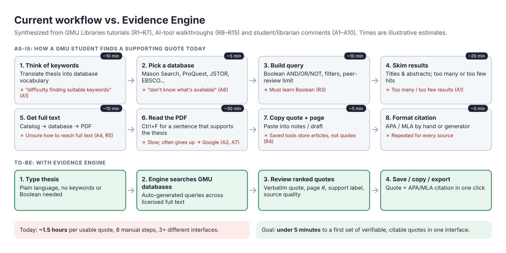
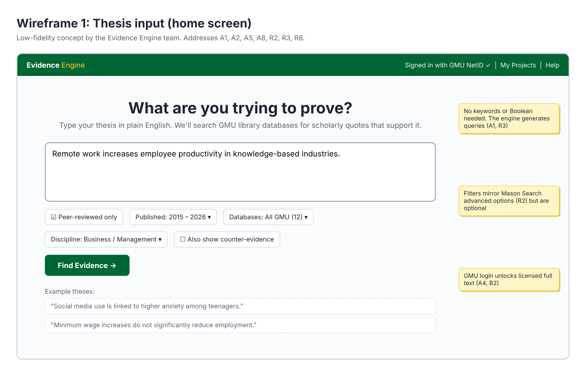
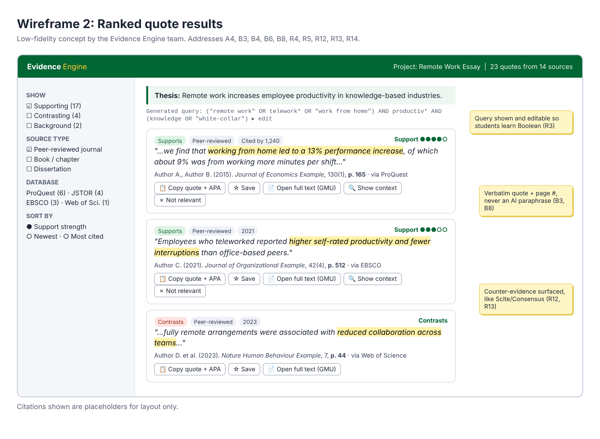
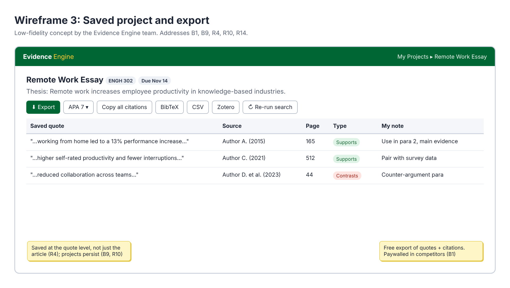

# Images: Screenshots and Figures

These figures show what Evidence Engine may look like and how users reach
their goals today. Each image lists the notes (A#, B#) and recordings (R#) it
draws on.

| Image | What it shows |
|-------|---------------|
| [`current-workflow.png`](current-workflow.png) | **As-is vs. to-be workflow.** The 8 manual steps a GMU student takes today to find one supporting quote, with pain points from the notes and videos, compared with the 4-step Evidence Engine flow. |
| [`mockup-thesis-input.png`](mockup-thesis-input.png) | **Wireframe 1: home screen.** A plain-language thesis box, optional filters, and GMU sign-in. |
| [`mockup-results.png`](mockup-results.png) | **Wireframe 2: results.** Ranked word-for-word quotes with page numbers, support or contrast labels, source quality, and one-click copy, save, and full-text links. |
| [`mockup-saved-project.png`](mockup-saved-project.png) | **Wireframe 3: saved project.** Quotes saved under each thesis, personal notes, and free export (APA/MLA, BibTeX, CSV, Zotero). |

### Previews






### Editing the figures

The figures are made from the HTML files in [`src/`](src/). To change one,
edit its HTML and re-render all of them:

```bash
cd requirements-elicitation/images/src
npm install playwright   # once
node render.js
```

### Screenshots of existing tools

Add your own screenshots of the tools students use today to
[`screenshots/`](screenshots/). See that folder's README for the list.
